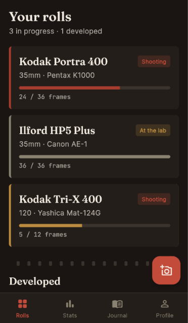
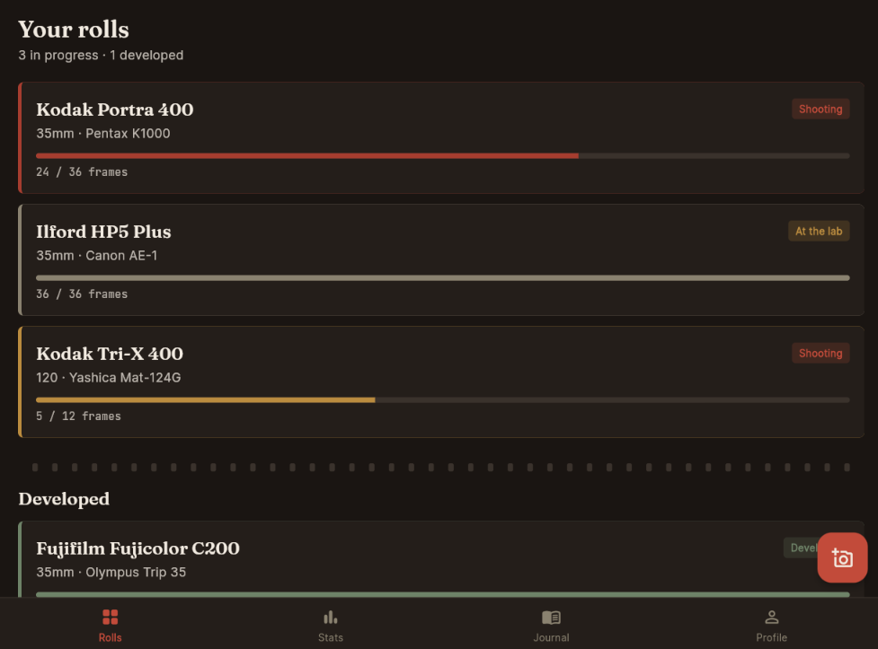
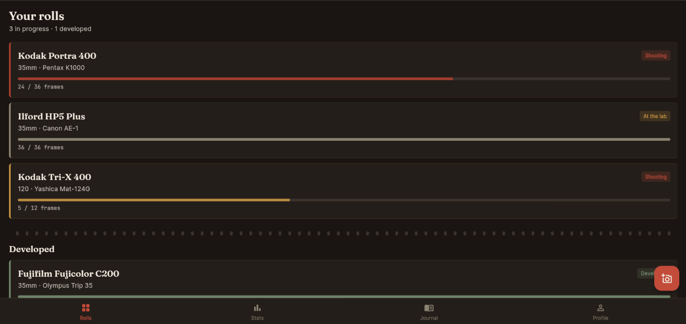

# Roll — Film Photography Companion

A Flutter application designed for analog film photographers to organize film rolls, record exposures, view photography statistics, and maintain a photography journal.

## Features

- Splash screen and onboarding screens
- Login and sign-up form validation
- Film roll cards and roll details
- Frame exposure form for aperture, shutter speed, ISO, and notes
- Statistics, journal, and profile screens
- Reusable Flutter widgets and a custom theme
- Responsive layouts tested on mobile, tablet, and laptop screen sizes
- REST API demonstration using the HTTP package
- API loading indicators and error handling
- Widget test for login form validation

## Technologies Used

- Flutter
- Dart
- Material Design widgets
- HTTP package
- REST API and JSON
- Flutter widget testing
- Git and GitHub

## Screenshots

### Mobile


### Tablet


### Laptop


## Project Structure

```text
lib/
  main.dart
  data/
    sample_data.dart
    film_api_service.dart
  models/
    film_roll.dart
  screens/
    splash_screen.dart
    onboarding_screen.dart
    login_screen.dart
    home_screen.dart
    roll_detail_screen.dart
    add_frame_screen.dart
    stats_screen.dart
    journal_screen.dart
    profile_screen.dart
  theme/
    app_theme.dart
  widgets/
    roll_card.dart
    roll_bottom_nav.dart
    sprocket_divider.dart

test/
  widget_test.dart

screenshots/
  mobile.png
  tablet.png
  laptop.png
```

## How to Run

Install Flutter and configure a supported device or browser.

Clone the repository:

```bash
git clone https://github.com/pranavvv0016/film-log-UI.git
cd film-log-UI
```

Install dependencies:

```bash
flutter pub get
```

Run static analysis:

```bash
flutter analyze
```

Run tests:

```bash
flutter test
```

Run in Chrome:

```bash
flutter run -d chrome
```

## API Integration

The application uses the Dart HTTP package to send an HTTP GET request to a public sample API. The response is decoded from JSON and displayed using a FutureBuilder with loading and error states.

The current endpoint returns sample grocery product data to demonstrate REST API integration; it is not a film-stock database.

## Testing

The project includes a widget test for login form validation.

Run the tests using:

```bash
flutter test
```

## Notes

This is an academic UI design project. The login form demonstrates client-side validation and does not implement real user authentication. Verify all screen interactions and data-saving behavior before describing them as completed features.
